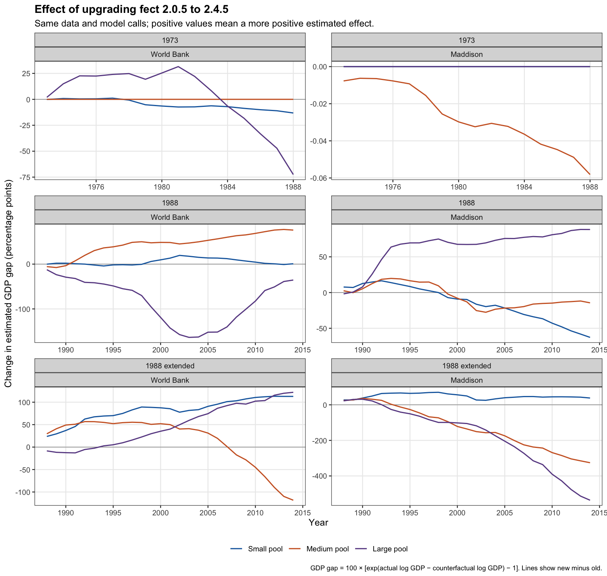

# fect version comparison

This controlled comparison reran all nine main specifications (18 dataset/pool panels) with fect 2.0.5 and 2.4.5. The input data, estimation calls, seed, and other installed packages were held fixed. Only the fect library selected by the runner changed.

## Practical differences

- The selected factor count changes in 15 of 18 panels.
- The average post-intervention GDP gap changes sign in two panels: the 1988 World Bank medium pool and the 1988 Maddison large pool.
- The final-year GDP gap changes sign in four panels.
- SCM and BSTSM estimates are exactly unchanged in this comparison.
- The largest absolute change in the average annual GDP gap is 174.1 percentage points; the largest single-year change is 536.5 percentage points. These large changes occur in specifications with extreme GSCM extrapolations.

These are comparisons of point estimates, not significance tests. They establish substantial sensitivity to upgrading the package with unchanged calls; they do not establish which version provides a better economic model. This comparison covers the main empirical specifications. The newer version was not used to rerun the full simulation and placebo exercises.

## All main panels

For each year, the percentage GDP gap is `100 * (exp(actual log GDP - counterfactual log GDP) - 1)`. The averages below are arithmetic averages of these annual percentage gaps over the post-intervention period, not percentages obtained by exponentiating the average log effect. Positive values mean actual GDP exceeds the estimated counterfactual.

The 1973 exercise averages 1973–1988. Both 1988 exercises average 1988–2014; “extended” refers to the longer pre-intervention sample. The small/medium/large donor pools contain 16/24/42 World Bank controls and 17/25/43 Maddison controls.

| Exercise | Dataset | Pool | Factors: 2.0.5 → 2.4.5 | Average gap: 2.0.5 | Average gap: 2.4.5 | Change, percentage points |
|---|---|---|---:|---:|---:|---:|
| 1973 | World Bank | Small | 1 → 3 | -10.05% | -15.08% | -5.03 |
| 1973 | World Bank | Medium | 1 → 1 | -9.34% | -9.34% | +0.00 |
| 1973 | World Bank | Large | 5 → 2 | -15.30% | -12.81% | +2.50 |
| 1973 | Maddison | Small | 1 → 1 | -12.21% | -12.21% | +0.00 |
| 1973 | Maddison | Medium | 1 → 2 | -11.30% | -11.33% | -0.03 |
| 1973 | Maddison | Large | 1 → 1 | -15.00% | -15.00% | +0.00 |
| 1988 | World Bank | Small | 1 → 4 | +36.56% | +41.62% | +5.06 |
| 1988 | World Bank | Medium | 4 → 1 | -14.59% | +30.25% | +44.84 |
| 1988 | World Bank | Large | 3 → 2 | +112.68% | +30.24% | -82.44 |
| 1988 | Maddison | Small | 2 → 1 | +35.85% | +21.26% | -14.59 |
| 1988 | Maddison | Medium | 4 → 1 | +24.11% | +19.39% | -4.72 |
| 1988 | Maddison | Large | 5 → 1 | -33.58% | +30.27% | +63.85 |
| 1988 extended | World Bank | Small | 5 → 1 | +10.20% | +92.27% | +82.07 |
| 1988 extended | World Bank | Medium | 4 → 1 | +105.53% | +120.51% | +14.99 |
| 1988 extended | World Bank | Large | 5 → 3 | +49.04% | +96.99% | +47.95 |
| 1988 extended | Maddison | Small | 5 → 1 | +35.70% | +83.71% | +48.01 |
| 1988 extended | Maddison | Medium | 5 → 2 | +191.67% | +63.15% | -128.52 |
| 1988 extended | Maddison | Large | 5 → 2 | +253.74% | +79.60% | -174.14 |

## Annual changes

Each panel has its own vertical scale. In particular, the 1973 Maddison changes are very small despite the visible slope.

Full precision results: [panel summaries](verification/fect_version_comparison.csv), [annual paths](verification/fect_version_annual.csv), and [summary counts](verification/fect_version_summary.json). The graph is also available as a [PDF](verification/fect_version_comparison.pdf).

## Reproduction guidance

Use the supplied lockfile and fect 2.0.5 to reproduce the publication. The runner permits other versions with a warning. Its numerical verifier compares against the pinned audit baseline, so changed GSCM results are expected to fail that comparison. The README describes how to test 2.4.5 in a separate copy. This does not resolve the separate STSM discrepancies documented in REPLICATION_NOTES.md.

Inspection of the installed package code shows changes in model-selection defaults, including the cross-validation configuration and selection rule. The comparison above measures the combined effect of upgrading with unchanged calls; it does not isolate one internal change as the sole cause.
